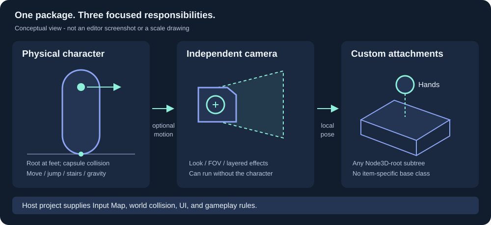

# FPSController

A reusable first-person character, independent camera rig, and generic Hands
attachment anchor for **Godot 4.7.1**.

## Start here

1. Copy the complete folder into your project as `res://FPSController/`, including
   script `.uid` files. Let Godot import it before using the scene factories.
2. Instance `fps_controller.tscn` in a 3D scene with a collision floor. Place its
   origin at the character's feet; keep the character upright at unit scale.
3. Assign `FPSControllerData` to the character and `FPSControllerCameraData` to
   its `CameraRig` child, or let initialization create default resources.
4. Configure the Input Map: the current implementation does **not** create input
   actions. See [setup and bindings](docs/getting-started.md#input-map).

Default action names are `fps_move_left`, `fps_move_right`, `fps_move_forward`,
`fps_move_backward`, `fps_walk`, `fps_run`, `fps_jump`, and `fps_release_mouse`.
Typical bindings are A/D/W/S, Ctrl, Shift, Space, and Escape.

The camera is current and captures the mouse on startup by default. Mouse release
and click-to-capture are configurable. The library requires no game autoloads,
weapon interfaces, or external assets.

**Current-source caveats:** scene factories use UIDs, and the supplied scenes have
`res://FPSController/` fallback paths. The current character initialization also
contains unresolved reference-order/accessor issues. See
[troubleshooting](docs/troubleshooting.md#current-source-initialization-caveats)
before integration; these documentation changes do not modify gameplay code.

## Documentation

| Guide | Contents |
| --- | --- |
| [Documentation map](docs/index.md) | Reading paths and visual guide |
| [Getting started](docs/getting-started.md) | Installation, scene setup, Input Map, resources |
| [Movement and collision](docs/movement.md) | Speeds, jump, gravity, stairs, landing |
| [Camera and independent control](docs/camera.md) | Look, FOV, effects, detached camera recipes |
| [Hands attachments](docs/hands.md) | Custom nodes/scenes, transforms, lifetime |
| [Configuration reference](docs/configuration.md) | Every exported option and default |
| [Scripting reference](docs/scripting.md) | Factories, methods, signals, integration examples |
| [Coordinates and visual effects](docs/coordinates-and-effects.md) | Feet origin, axes, pitch, composed camera offsets |
| [Architecture and portability](docs/architecture.md) | Scene hierarchy, lifecycle, dependencies, UID relocation |
| [Troubleshooting](docs/troubleshooting.md) | Initialization, input, stairs, cameras, attachments |

Images are original conceptual SVG illustrations, not editor screenshots.
