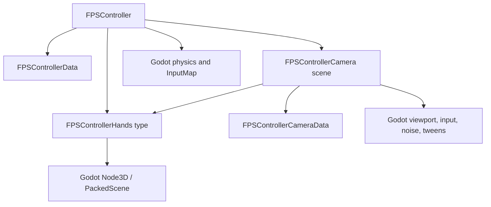

# Architecture and portability

[Documentation map](index.md) | [Next: Troubleshooting](troubleshooting.md)

This page describes implementation and integration boundaries. It does not add
requirements to attachment scenes or require host game classes.

## Files and responsibilities

```text
FPSController/
  fps_controller.gd               CharacterBody3D logic
  fps_controller_data.gd          character settings and MoveType
  fps_controller.tscn             physical character + rig instance
  camera/
    fps_controller_camera.gd     look, capture, FOV, procedural effects
    fps_controller_camera_data.gd
    fps_controller_camera.tscn   complete reusable camera rig
  hands/
    fps_controller_hands.gd      generic Node3D attachment API
  resources/icons/               custom SVG class icons
  docs/                          guides and original SVG diagrams
```

Keep script UID sidecars with their scripts. Both Data classes extend
`Resource`; neither currently forces `resource_local_to_scene`.

## Scene hierarchy and unique names

```text
FPSController (CharacterBody3D)
  CameraRig (FPSControllerCamera scene instance)
    CameraRotationH
      CameraPivotStepping
        CameraRotationV
          CameraPivotLanding
            CameraPivotBobbing
              CameraPivotShake
                Camera (Camera3D)
                  Hands (FPSControllerHands)
  Collision (CollisionShape3D)
  RayCeilingAbove (RayCast3D)
```

Unique-name references such as `%CameraRig`, `%Collision`, and `%Camera` are part
of each scene's internal contract. Internal camera pivots belong to the nested
rig's scene scope. Obtain the rig first rather than assuming `%Hands` resolves
from the character owner.

The scripts expect these child hierarchies; `.new()` on the custom classes is
not a scene factory. Hands alone can be constructed as an ordinary node because
its script needs no fixed child hierarchy.

## Dependencies



The camera rig has no reverse dependency on the character. It can be copied
with its Data, Hands, corresponding icons, and UID sidecars for a camera-only
package, provided scene fallback paths/UID references remain valid.

No runtime reference requires the old game Player, a weapon/tool base, a game
autoload, or map objects. Host physics/input/viewport configuration still
matters; “standalone” does not mean “no project configuration.”

## Lifecycle

Godot calls `_enter_tree()` before evaluating `@onready` fields; children become
ready before their parent. The current character accesses its onready rig
reference in `_enter_tree()`, which is a known mismatch with that lifecycle.
See [initialization caveats](troubleshooting.md#current-source-initialization-caveats).

After valid references are available, the intended startup responsibilities are:

```mermaid
sequenceDiagram
    participant Host
    participant Body as Character
    participant Rig
    Host->>Body: Add instanced scene
    Note over Body,Rig: Early input lock must resolve nodes before onready
    Rig->>Rig: Apply follow mode; update Data/FOV/effects
    Rig->>Rig: Apply current camera and optional capture
    Body->>Body: Apply capsule, masks, eye height, floor snap
    Body->>Rig: Update rig and apply disabled-input policy
    Body-->>Host: updated(true/false)
```

This diagram explains ownership and intended order; it is not evidence that the
current initialization mismatch has been fixed.

## Physics flow

The character samples movement input, applies gravity, accelerates, handles jump,
attempts steps, then moves/slides/snaps. It updates grounded/fall state and feeds
the rig when synchronization is enabled.

The rig independently blends FOV and updates step recovery, bobbing, and shake
on its physics tick. Landing uses its own physics-process tween. Disabling body
physics alone does not stop rig processing; global pause/process modes still
apply.

## UIDs and relocation

The current factory constants are:

| Class | Scene UID |
| --- | --- |
| `FPSController.PACK_UID` | `uid://dlsx5ttt5rpdj` |
| `FPSControllerCamera.PACK_UID` | `uid://b16xsdj61gw6d` |

Unlike the earlier script-relative factories, these call `load(PACK_UID)`.
The scenes carry matching UIDs and external-resource UID references, plus
fallback paths rooted at `res://FPSController/`.

For reuse:

1. Copy the complete package, including `.gd.uid` files and scene UID headers.
2. Let the destination editor import it and build its UID registry.
3. Keep the matching original location for the least-friction initial import.
4. Move resources through Godot's FileSystem dock if relocating, and confirm
   external-resource fallback paths and factory scene resolution afterward.

Do not distribute a stale `.godot` cache or assume a copied project already
knows these UIDs before import. Importing two copies of the package into one
project risks duplicate UIDs and duplicate global `class_name` registrations.
Avoid that; it is not a supported namespaced multi-version installation.

Class icons use script-relative paths, so the icon folder must retain the
expected relationship to scripts. No documentation image is a runtime asset.

## Extending without game coupling

Use character signals for footsteps/gameplay events, the Hands API for custom
visuals, and rig methods for camera requests. Keep fall damage, inventory,
world-specific rules, UI, and camera-positioning policies in host scripts.

Assigned settings resources can be shared, but disabled flags, velocity,
movement toggles, tweens, bob phase, and shake state belong to individual nodes.
