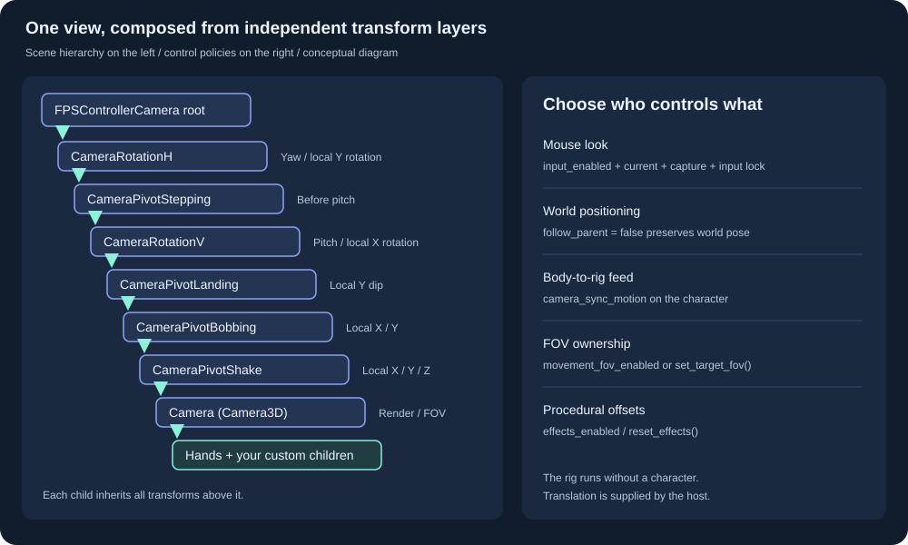

# Camera and independent control

[Documentation map](index.md) | [Configuration](configuration.md) | [Next: Hands](hands.md)



## The rig

`FPSControllerCamera` extends `Node3D`, not `Camera3D`. Its nested `camera`
reference is the actual rendering camera. Instance its supplied scene rather
than attaching the script to an empty node.

The rig owns yaw, pitch, step/landing/bobbing/shake pivots, a `Camera3D`, and
Hands. It does not depend on `FPSController` or `FPSControllerData`. Its own
resource is `FPSControllerCameraData`.

## Mouse look and capture

Mouse look requires a current rendering camera, `input_enabled`, no external
input block, captured mouse, and Data `look_enabled`.

Motion uses `-event.screen_relative * look_speed`, with optional per-axis
inversion. Yaw is unrestricted; pitch is clamped between the negative downward
limit and positive upward limit. Defaults are `60` degrees down and `80` up.
`look_speed` defaults to `0.005` radians per screen-relative mouse unit.

`capture_mouse_on_ready` and `capture_mouse_on_click` default to true.
`set_mouse_captured()` directly changes Godot's global mouse mode. The configured
release action still releases capture while the current rig is input-blocked,
`input_enabled` is false, or look is disabled. A missing release action has no
effect.

Changing `camera_current` at runtime applies to the actual camera immediately.
When other cameras switch the active view, inspect `camera.is_current()` for
the actual viewport state; the exported flag records this rig's requested
setting, not every external camera switch.

## Independent-control options

| Owner | Option | Default | Meaning |
| --- | --- | --- | --- |
| Character | `camera_independent_input` | `false` | Allow rig input even while character is disabled |
| Character | `camera_sync_motion` | `true` | Feed movement FOV, bobbing state, stair smoothing, and landing dip |
| Character | `movement_follows_camera` | `true` | Move relative to camera orientation rather than body orientation |
| Character | `movement_requires_current_camera` | `true` | Require this rig's camera to be current for movement |
| Character | `movement_requires_mouse_capture` | `true` | Require captured mouse for movement |
| Rig | `input_enabled` | `true` | Enable automatic mouse look and click capture |
| Rig | `follow_parent` | `true` | Inherit the parent's transform |
| Rig | `movement_fov_enabled` | `true` | Permit character movement to choose FOV |
| Rig | `effects_enabled` | `true` | Enable procedural visual offsets |

`set_input_blocked()` is an external lock, separate from `input_enabled`. The
character writes that lock on initialization and when its disabled/independent
state changes. Do not treat it as a stack of independently owned locks.

## Scripted look

The following assumes an existing, ready rig:

```gdscript
extends Node3D

@onready var camera_rig: FPSControllerCamera = $FPSControllerCamera

func _ready() -> void:
	camera_rig.input_enabled = false
	camera_rig.set_look(Vector2(deg_to_rad(30.0), deg_to_rad(-15.0)))
	camera_rig.look(Vector2(deg_to_rad(5.0), 0.0))
```

Angles are local yaw/pitch **in radians**. Scripted methods still clamp pitch,
emit `look_changed`, and work while mouse input is disabled or blocked.
They do not rotate the character body.

## FOV

The camera target is the selected FOV plus `camera_fov_modifier`, clamped to
`1..179` degrees. Transition uses exponential smoothing with the configured
rate. A zero transition rate freezes blending; an instant command still applies.

Character-driven FOV uses normal/walk/run defaults `65/60/75`. To set your own
target without the character overwriting it next physics tick:

```gdscript
extends Node3D

@onready var controller: FPSController = $FPSController

func _ready() -> void:
	var camera_rig: FPSControllerCamera = controller.camera_rig
	camera_rig.movement_fov_enabled = false
	camera_rig.set_target_fov(45.0, true)
```

The second argument is named `instant` in the current API. The modifier is still
added. Editing `camera.fov` directly does not replace the rig's stored target.

## Look while the body is disabled

Set `controller.camera_independent_input = true` before calling
`controller.set_disabled(true)`. This leaves look/capture available but does not
stop gravity or detach the camera. Set rig `input_enabled = false` to suppress
mouse look independently of movement.

For movement with the cursor released, also set
`movement_requires_mouse_capture = false`. To continue movement while another
camera is active, set `movement_requires_current_camera = false`.

## Detach from the body's transform

```gdscript
extends Node3D

@onready var controller: FPSController = $FPSController

func _ready() -> void:
	controller.camera_independent_input = true
	controller.camera_sync_motion = false
	controller.movement_follows_camera = false
	controller.camera_rig.follow_parent = false
	controller.camera_rig.global_position = Vector3(0.0, 3.0, 5.0)
	controller.camera_rig.set_look(Vector2(0.0, deg_to_rad(-15.0)))
```

`follow_parent` toggles `top_level`, preserving world pose. The rig remains a
child in the scene tree and is still freed with the parent. It has no automatic
free-flight translation; move `global_transform` yourself.

Character `update()` does not reapply eye height while following is disabled,
but it **does** update the rig, reset FOV, and clear effects. Re-enabling following
preserves the current pose; eye height is restored on the next character update,
not all position/rotation components.

## Standalone camera

```gdscript
extends Node3D

func _ready() -> void:
	var camera_data: FPSControllerCameraData = FPSControllerCameraData.new()
	var camera_rig: FPSControllerCamera = FPSControllerCamera.instantiate(camera_data)
	if camera_rig == null:
		return
	camera_rig.capture_mouse_on_ready = false
	camera_rig.input_enabled = false
	add_child(camera_rig)
	camera_rig.global_position = Vector3(0.0, 3.0, 5.0)
	camera_rig.set_target_fov(50.0, true)
```

This uses the UID factory; import the scene first. Set exported options before
adding it, then use onready references and pose/effect methods after readiness.
The current rig has no `get_camera()` or `get_hands()` accessor: use `.camera`
and `.hands` once ready.

A standalone rig can receive `set_motion_state()` from any host script for
bobbing/recovery, plus explicit `smooth_step_from()`, `animate_landing()`, and
`shake()` calls. It does not infer a parent body's velocity automatically.

## Visual effects

`effects_enabled = false` immediately clears every procedural offset and kills
the landing tween. It does not disable look or FOV processing.

`camera_sync_motion = false` only stops character-to-rig feeds. It sends a
stationary motion state so bobbing recenters, but does not kill a running landing
tween or shake, clear every offset instantly, or change the last FOV target.
Use `reset_effects()` for an immediate reset.

See [coordinates and effects](coordinates-and-effects.md) for composition and
[scripting reference](scripting.md#fpscontrollercamera) for all rig methods.
