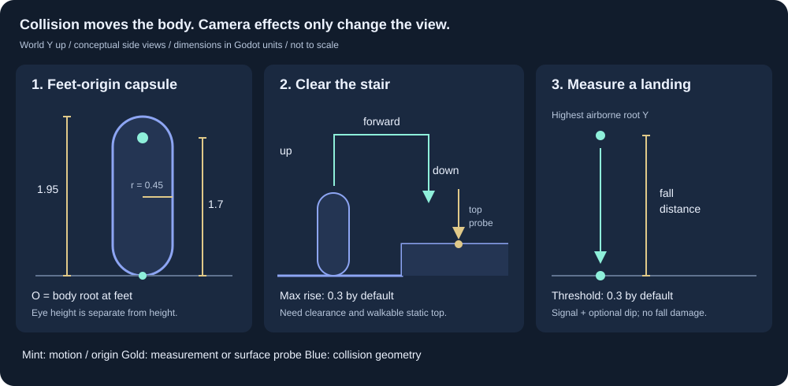
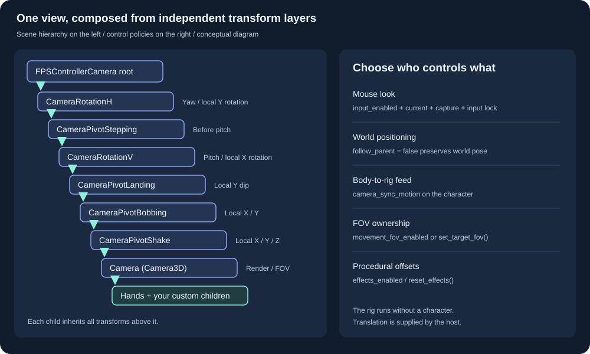

# Coordinates and visual effects

[Documentation map](index.md) | [Next: Architecture](architecture.md)



## Feet-origin character

The character root is at the feet. Its capsule is centered at local
`Y = collision_height / 2`, with default radius `0.45` and total height `1.95`.
The camera rig starts at local Y `1.7`. Capsule height and eye height are
independently configurable; there is no automatic crouch or eye-height clamp
against capsule dimensions.

```text
                  +Y up
                    ^
      head   .------|------.
             |    eye     |  rig Y = 1.7
             |            |
             |  capsule   |  total height = 1.95
             |            |
      feet   '------+-----'
                    O--------> +X right
                  root
            forward = local -Z
```

Keep the body upright and unit-scaled. Although gravity comes from Godot,
custom stair probes and fall measurements explicitly use world Y.

## Rotation units and direction

`get_look()` returns `Vector2(yaw, pitch)` in radians. A positive local pitch
looks up from the initial forward `-Z` direction. Limits in camera Data are
positive degree magnitudes, converted internally.

`set_look(Vector2(0, 0))` resets the two look pivots, not the rig root's transform.
If the root or its parent is rotated, zero look angles still inherit that
orientation. `get_yaw_basis()` is world-space; its result includes parent/root
transforms as well as local yaw.

`follow_parent = false` makes the root top-level, preserving its world pose.
It does not remove the rig from the scene tree.

## Pivot order



The scene order is:

```text
Rig root
  Yaw
    Step offset
      Pitch
        Landing offset
          Bobbing offset
            Shake offset
              Camera
                Hands
                  Custom attachment pose
```

Each child inherits all transforms above it. Step offset is before pitch;
landing, bobbing, and shake are after pitch, so their local offsets follow the
view orientation. This is transform composition, not simply addition of
world-space vectors.

## Step smoothing

After an eligible body height change, the character supplies the old step-pivot
world Y. The rig offsets that pivot to preserve visual continuity, then moves
its local Y back toward zero.

Recovery clamps the offset to `+/-step_max_smoothing` and uses:

```text
speed = max(horizontal_motion_speed, selected_movement_speed / 2)
recovery_per_frame = max(0.1, speed) * delta
```

The old world height is only applied while effects, step smoothing, and parent
following are enabled. Disabling step smoothing clears the offset on the next
rig physics update. This visual system does not change character collision.

## Head bob

When enabled, grounded, moving, and faster than `0.01` horizontally, phase grows
with traveled horizontal distance:

```text
distance += horizontal_speed * delta
phase = distance * max(0, bob_frequency)
target.x = sin(phase / max(0.001, bob_smoothing_horizontal)) * amplitude
target.y = cos(phase / max(0.001, bob_smoothing_vertical)) * amplitude
target.z = 0
```

Offset interpolation uses `1 - exp(-10 * delta)`. Without a valid moving state,
the target becomes zero, allowing recentering. Turning off `bob_enabled`
recenters rather than freezing the existing offset. A reset clears the phase.

## Landing dip

Landing amplitude comes from the character's measured fall distance unless an
external host calls `animate_landing()` directly. The rig moves landing-pivot
local Y toward `-amplitude`, then back to zero, using physics-process tweens.

Default contact/recovery durations are `0.05/0.75` seconds. Both segments use
Back/Out easing; the animation can overshoot its nominal target. Starting a new
landing kills the previous tween and resets the pivot before replaying.

## Shake

`shake(strength, duration)` is positional noise, not camera rotation. Strength
is a distance in 3D units; duration is seconds. Positive calls create noise
lazily and retain the strongest active strength and longest remaining duration.
They do not sum shake amplitudes.

Noise time advances at `30 * delta`, with separate sample offsets for X/Y/Z.
Intensity fades as remaining time divided by the stored duration. Completion
resets the shake pivot to zero. A reset also stops shake immediately.

## What reset and disable actually affect

| Operation | Look | FOV | Procedural effects |
| --- | --- | --- | --- |
| `input_enabled = false` | Mouse off; scripted commands work | Continues | Continue |
| `effects_enabled = false` | Continues | Continues | Immediately cleared and suppressed |
| `reset_effects()` | Preserved | Preserved | Offsets/tween/shake/phase cleared; supplied motion remains |
| Rig `update()` | Pitch clamped | Normal target applied instantly | Reset |
| `camera_sync_motion = false` | Unchanged | Last target retained | Character feed stops; existing effects recover/finish |

The character's disabled state is an input policy, not a pause.
