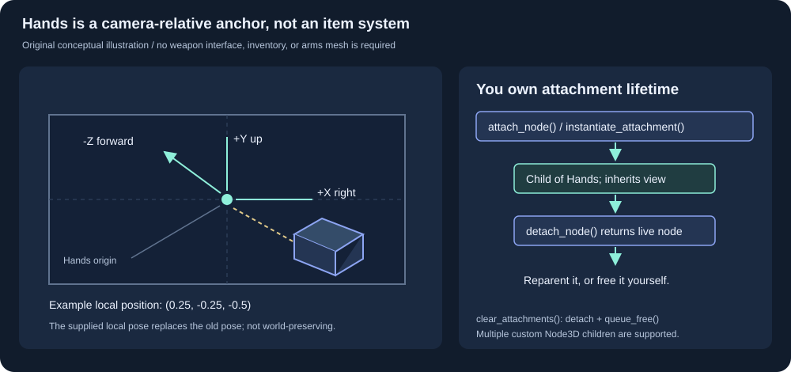

# Hands attachments

[Documentation map](index.md) | [Scripting reference](scripting.md) | [Next: Configuration](configuration.md)



## What Hands is

`FPSControllerHands` is a `Node3D` under the camera, not an arms mesh or a
project-specific tool base. It can hold multiple custom `Node3D` subtrees.
Attachments inherit camera look and all camera-pivot effects.

No inventory, weapon selection, interaction interface, recoil, or animation
protocol is required. Those systems belong to your host project.

## Attach an existing node

```gdscript
extends Node3D

@onready var controller: FPSController = $FPSController

func _ready() -> void:
	var held_object: Node3D = Node3D.new()
	var attachment_pose: Transform3D = Transform3D(
		Basis.IDENTITY, Vector3(0.25, -0.25, -0.5)
	)
	if not controller.attach_to_hands(held_object, attachment_pose):
		held_object.free()
```

The supplied transform is local to Hands and replaces the node's old local
transform. Identity is the default. Negative local Z is forward; positive X is
right; negative Y is down.

An already-parented attachment is removed from its old parent before addition.
This is not a world-transform-preserving reparent. Lifecycle callbacks may run
when moving between parents; account for this in custom attachment scripts.

The current controller forwarding methods use onready references, so call them
after the controller is ready. For a standalone ready rig, use
`camera_rig.hands.attach_node(...)` directly.

## Instance an attachment scene

```gdscript
extends Node3D

@export var attachment_scene: PackedScene
@onready var controller: FPSController = $FPSController

func _ready() -> void:
	var attachment_pose: Transform3D = Transform3D(
		Basis.IDENTITY, Vector3(0.25, -0.25, -0.5)
	)
	var attachment: Node3D = controller.instantiate_in_hands(
		attachment_scene, attachment_pose
	)
	if attachment == null:
		return
	attachment.name = "CustomHeldObject"
```

The PackedScene must be non-null, instantiable, and have a `Node3D` root.
A rejected instance is freed by `instantiate_attachment()`; the caller receives
null. `attach_node()` itself does not free a supplied node when attachment fails.

## Detach and lifetime

```gdscript
extends Node3D

@onready var controller: FPSController = $FPSController

func discard_attachment(attachment: Node3D) -> void:
	var detached: Node3D = controller.detach_from_hands(attachment)
	if detached != null:
		detached.queue_free()
```

Detachment returns a live, unparented node without preserving its former world
pose. Reparent or free it yourself. To drop an item into the world, capture
`attachment.global_transform` **before** detaching, add it to the world, and then
restore that world transform.

`clear_attachments()` removes direct nonqueued `Node3D` children immediately and
queues them for deletion. Other direct child types and queued children are not
returned by `get_attachments()`. When the rig is freed, remaining child
attachments are freed with it.

Runtime attachment APIs do not set `owner`; they do not automatically serialize
attachments into an editor scene.

## Validation and signals

| Operation | Behavior |
| --- | --- |
| Invalid or queued node | `attach_node()` returns false |
| Hands itself or an ancestor | Rejected to prevent a tree cycle |
| Existing direct child | Pose updated, true returned; no duplicate addition signal |
| New attachment/reparent | `attachment_added(attachment)` emitted after addition |
| Valid direct-child detachment | `attachment_removed(attachment)` emitted after removal |
| Detach invalid/nonchild node | Null returned |

Attachment signals describe API operations, not every possible scene-tree
change. Directly calling `add_child()`, `remove_child()`, or freeing an attachment
does not automatically emit these custom signals.

## Practical placement

Start near `(0.25, -0.25, -0.5)` and tune model scale/pivot in its own scene.
The anchor has no special rendering layer, collision exclusions, or clipping
prevention. Configure custom colliders and the camera's inherited near plane
deliberately. Attaching a physics body does not make its simulation
camera-relative in a physically meaningful way; a visual `Node3D` subtree is the
simplest attachment.
