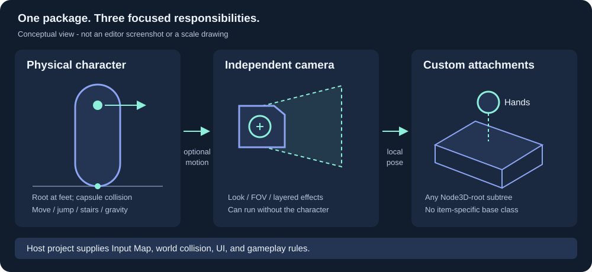
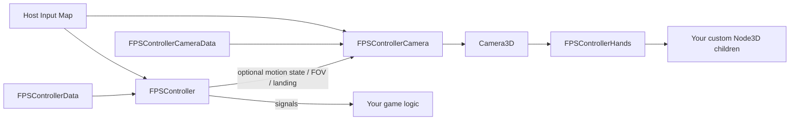

# FPSController documentation

[Package README](../README.md)

The package consists of a physical character, a camera rig that can run without
that character, and a camera-relative attachment anchor. These guides describe
the **current source**, including changes to input registration, factory loading,
and public references.

## Choose a reading path

| Goal | Read |
| --- | --- |
| Put a character into a level | [Getting started](getting-started.md), then [movement](movement.md) |
| Use the camera separately | [Camera](camera.md), then [coordinates/effects](coordinates-and-effects.md) |
| Attach a custom held object | [Hands](hands.md) |
| Tune every setting | [Configuration reference](configuration.md) |
| Integrate game logic | [Scripting reference](scripting.md) |
| Move the package or understand lifecycle | [Architecture and portability](architecture.md) |
| Diagnose a problem | [Troubleshooting](troubleshooting.md) |

## Mental model

The arrows from the character to the rig can be disabled. The rig does not
implement character collision or free-flight translation. Hands does not
implement an inventory, item switching, shooting, or animation state machine.

## Conventions

- Distances are Godot 3D units; durations are seconds.
- Inspector angle settings are degrees; scripted yaw/pitch are radians.
- “Data” means a settings resource, not runtime state. Locks and effects belong
  to the nodes; changing a shared resource changes settings for every user.
- “Moving” means nonzero accepted movement input, not confirmed displacement.
- Diagrams are explanatory and not to scale. SVGs work without Mermaid support;
  Mermaid diagrams provide additional flow and lifecycle views.

Start with the
[current-source initialization notes](troubleshooting.md#current-source-initialization-caveats)
if using the character scene or its factory.

[Next: Getting started](getting-started.md)
