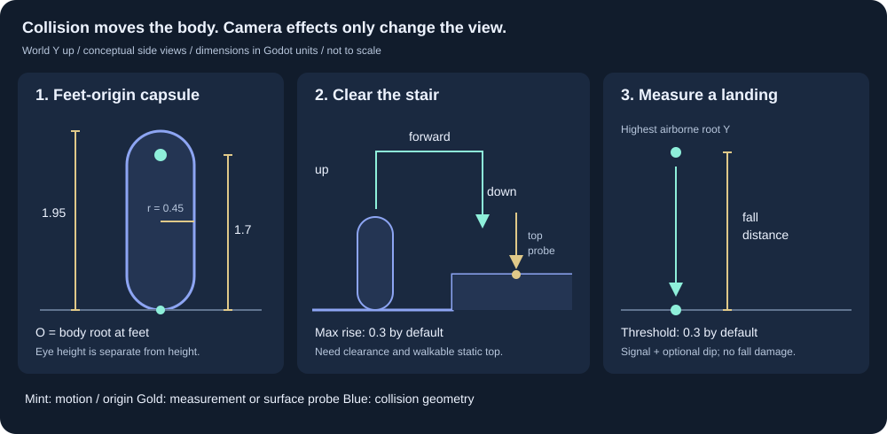
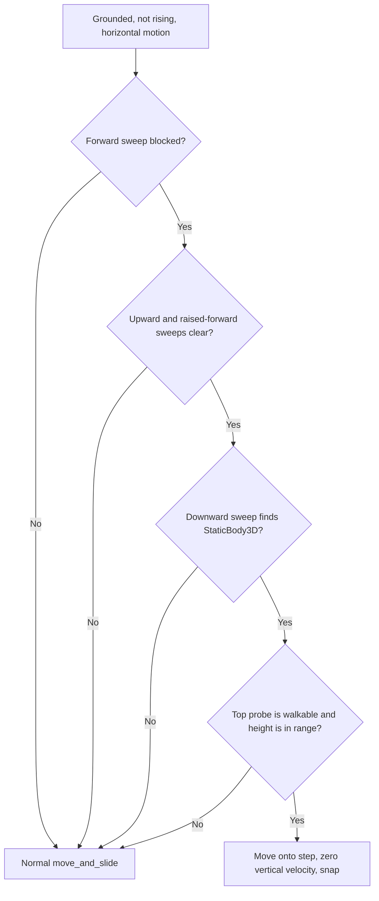

# Movement and collision

[Documentation map](index.md) | [Configuration](configuration.md) | [Next: Camera](camera.md)



## Horizontal movement

Accepted input is combined into an X/Z direction and limited to length `1`, so
diagonal input does not increase the target speed. Partial action strengths can
produce slower motion.

By default, movement uses the rig's world yaw basis, flattened onto X/Z. Looking
up does not make normal movement climb. Set `movement_follows_camera = false`
to use the character's world basis instead. The character body itself is not
automatically rotated by mouse look.

| Mode | Default speed | Selection |
| --- | --- | --- |
| `NORMAL` | `5.0` | No eligible walk/run request |
| `WALK` | `2.0` | Walking requested and enabled |
| `RUN` | `10.0` | Running requested and enabled; takes precedence over walking |

Walk/run selection requires movement input and either grounding from the
previous movement step or flight mode. A moving airborne character normally
selects `NORMAL`, even with run held.

`move_walk_toggled` and `move_run_toggled` switch each action from hold to toggle.
Enabling one toggle cancels the opposite toggle. `update()` and disabled-state
changes clear both toggles.

## Acceleration and friction

The character approaches the target horizontal velocity with an exponential
blend:

```text
weight = 1 - exp(-max(0, rate) * physics_delta)
new_velocity = lerp(current_velocity, target_velocity, weight)
```

`move_acceleration` is the rate while input is present; `move_friction` is the
rate when it is absent. Defaults are `2.5` and `5.0`. These are response rates,
not a constant acceleration in units/second-squared. A zero rate prevents that
blend from changing velocity.

`move_enabled = false` rejects movement requests and jumping but does not stop
gravity. Friction still approaches zero horizontal velocity. In contrast,
`set_disabled(true)` immediately zeros X/Z velocity.

`is_moving()` reports accepted input: walking into a wall can still return true.
`get_current_speed()` reports selected mode speed, not measured motion. Use
Godot's `get_real_velocity()` when you need actual displacement-based velocity.

## Jumping

A jump needs all of the following:

- Accepted character input, movement enabled, and jumping enabled.
- Grounding from the previous movement step, flight disabled, and an expired
  jump cooldown.
- A configured jump action with an active request.
- No collision on the ceiling ray.

`jump_continuous = false` uses the just-pressed action; when true, holding jump
can jump again after landing and cooldown. Defaults: velocity `10.0`, cooldown
`0.25` seconds, ceiling clearance `0.15` units.

The ceiling ray starts at the configured capsule height and points upward by at
least `0.001` units. It uses the character's collision mask and excludes the
character itself. It is a ray, not a full capsule-shaped overhead test.

## Gravity and flight

When `fall_enabled` is true and flight is off, the character adds
`get_gravity() * max(0, fall_weight) * delta` to velocity. The default weight is
`2.0`; gravity therefore also depends on the destination project's physics.
Disabling gravity does not clear an already-existing vertical velocity.

`fall_fly_enabled = true` suppresses gravity and jump. Full camera orientation
drives motion, including pitch; if `movement_follows_camera` is false, the
character basis drives it instead. Flight retains collision movement but has no
separate ascend/descend actions. Grounded reporting is false in flight.

## Stairs

`step_enabled` enables step attempts and sets floor snap to `step_max_height`
(default `0.3`). With steps disabled, update sets snap length to `0.1`.



`AnimatableBody3D` qualifies through its `StaticBody3D` inheritance. Arbitrary
rigid bodies are not accepted as stair targets. Top slope must satisfy the
inherited `floor_max_angle`. Detected height must exceed `0.01` and not exceed
the configured maximum.

Upward/raised-forward sweeps guard against moving through overhangs or walls.
A separate surface ray checks the top because a capsule contacting a stair edge
can produce a steep contact normal even on a flat stair.

Camera smoothing is separate from step collision. Eligible height changes pass
the previous step-pivot world height to the rig, which eases its offset back to
zero. Disable rig `data.step_smoothing_enabled` to keep climbing without the
visual smoothing; disable `camera_sync_motion` to stop character-driven effects.

## Falling and landing

While airborne, the character tracks its highest root Y. On landing:

```text
fall_distance = max(0, peak_root_y - current_root_y)
amplitude = clamp(fall_distance * multiplier, 0, maximum)
```

With defaults, the multiplier is `0.225`, the cap is `0.45`, and the minimum
qualifying distance is `0.3`. `fall_impact_enabled` gates both the `landed`
signal and the character-requested landing animation. It does not impose damage.

Rig `fall_impact_tween_enabled` controls the visual dip independently: turning it
off does not stop qualifying `landed` signals. Turning off `camera_sync_motion`
also leaves landing detection/signals active.

## Scope and limits

This is a Y-up capsule controller, not an arbitrary-gravity, crouching, climbing,
swimming, network-prediction, or fall-damage system. Moving-platform behavior
outside the custom stair check uses inherited `CharacterBody3D` behavior.
